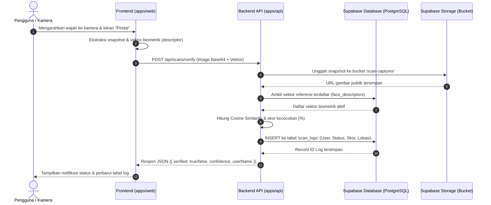

# 🏗️ Arsitektur Monorepo & Desain Sistem

Dokumen ini menjelaskan struktur monorepo, paket kerja (npm workspaces), pembagian peran antara Frontend dan Backend, serta alur data pemrosesan biometrik wajah.

---

## 1. Struktur Direktori Proyek

Proyek ini menggunakan **npm workspaces** standar, memungkinkan manajemen dependensi terpusat, code sharing tanpa duplikasi, dan proses build terpadu:

```
FaceScan/
├── apps/
│   ├── web/                     # Frontend Application (React 18 + Vite + Tailwind CSS)
│   │   ├── src/
│   │   │   ├── components/      # UI Components (CameraScanner, DashboardStats, dsb)
│   │   │   ├── services/        # Klien API dan Supabase Client
│   │   │   ├── App.tsx          # Main View Layout & Tab Router
│   │   │   └── main.tsx         # Entrypoint React
│   │   ├── index.html
│   │   ├── vite.config.ts
│   │   └── package.json
│   │
│   └── api/                     # Backend API Service (Express.js + TypeScript)
│       ├── src/
│       │   ├── config/          # Konfigurasi environment & port
│       │   ├── controllers/     # Controller logika bisnis (Scan, Auth, Stats)
│       │   ├── middleware/      # Auth Bearer Token & Error Handlers
│       │   ├── routes/          # Express Routers
│       │   ├── services/        # Face Recognition Service & Supabase Admin
│       │   └── index.ts         # Entrypoint Server Express
│       ├── tsconfig.json
│       └── package.json
│
├── packages/
│   ├── shared/                  # Kode & Tipe Bersama (Shared Code)
│   │   ├── src/
│   │   │   ├── constants/       # Konstanta (Status, Role, Scan Type, Endpoints)
│   │   │   ├── schemas/         # Skema validasi Zod
│   │   │   ├── types/           # Interface & tipe data TypeScript
│   │   │   └── utils/           # Cosine similarity & helper kalkulasi
│   │   └── package.json
│   │
│   └── supabase-config/         # Modul Konfigurasi Supabase
│       ├── src/
│       │   ├── admin.ts         # Server-side Supabase Admin (Service Role)
│       │   ├── client.ts        # Client-side Supabase Client (Anon Key)
│       │   └── database.types.ts# Definisi tipe TypeScript skema database
│       └── package.json
│
├── supabase/                    # Infrastruktur Supabase
│   ├── functions/               # Supabase Edge Functions (Deno)
│   │   └── face-verify/         # Edge function verifikasi wajah
│   ├── migrations/              # SQL Migrations (Tabel, Relasi, Triggers, RLS)
│   ├── seed.sql                 # Data awal untuk testing/pengujian
│   └── config.toml              # Konfigurasi lokal Supabase CLI
│
├── docs/                        # Dokumentasi Lengkap Proyek
│   ├── README.md                # Indeks dokumentasi
│   ├── ARCHITECTURE.md          # Dokumen ini
│   ├── GETTING_STARTED.md       # Panduan instalasi dan menjalankan proyek
│   ├── BACKEND_SUPABASE.md      # Detail skema DB, RLS, dan Storage
│   ├── API_REFERENCE.md         # Dokumentasi Endpoint REST API
│   └── DEPLOYMENT.md            # Panduan rilis produksi
│
├── .editorconfig
├── .env.example                 # Template variabel lingkungan terpusat
├── .gitignore
├── .prettierrc
├── package.json                 # Konfigurasi Root Monorepo
└── README.md                    # Ringkasan Proyek
```

---

## 2. Diagram Alur Kerja Sistem (Data Flow)

Alur berikut menggambarkan bagaimana pemindaian wajah diproses dari browser pengguna hingga tersimpan secara aman di Supabase:



---

## 3. Keunggulan Arsitektur Ini

1. **Pemisahan Tanggung Jawab (Separation of Concerns)**:
   - Frontend fokus pada pengalaman pengguna, akses perangkat kamera, dan rendering responsif.
   - Backend memegang kendali atas validasi payload, operasi kredensial sensitif (*Service Role Key*), dan kalkulasi biometrik.
   - Supabase menangani integritas data relasional, otentikasi sesi, dan penyimpanan file objek.

2. **Konsistensi Tipe End-to-End**:
   - Skema Zod dan tipe TypeScript didefinisikan satu kali di `@facescan/shared` dan langsung digunakan di Frontend maupun Backend.
   - Menghilangkan bug akibat inkonsistensi nama properti atau format data antara request dan response.

3. **Isolasi Kredensial Keamanan**:
   - `SUPABASE_SERVICE_ROLE_KEY` hanya pernah diakses di sisi Backend (`apps/api`), tidak pernah bocor ke bundler frontend (`apps/web`).
   - Frontend hanya menggunakan `SUPABASE_ANON_KEY` dengan pembatasan hak akses berbasis Row Level Security (RLS).
