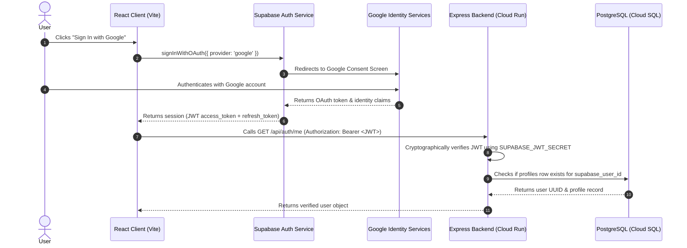

# 🛡️ Authentication, Security, and Privacy Architecture

## 1. Authentication Flow: Supabase Auth with Google OAuth

Authentication is managed via **Supabase Auth** utilizing **Google OAuth 2.0 PKCE** flow:

---

## 2. Zero-Video Upload Guarantee & Ethical AI

### Zero Raw Video Storage
- **Technical enforcement**: The Express backend possesses zero endpoints that accept raw image blobs or video streams.
- All camera stream consumption occurs strictly via `HTMLVideoElement` and WebAssembly `canvas.getContext('2d')`.
- Sessions recorded by users save only statistical summaries:
  - Dominant expression category (e.g. `Happy`).
  - Total frames analyzed (e.g. `184`).
  - Average confidence score (e.g. `89.4%`).
  - Mathematical percentage distribution across the 7 categories.

### Ethical Limits of Facial Expression Analysis
In accordance with ethical AI charters:
1. Facial expression classification indicates physical displacement of facial muscle groups (Action Units).
2. It **must not** be claimed or represented as a deterministic measurement of internal human emotions, mood, intent, or mental health.
3. The platform strictly prohibits usage for automated hiring decisions, psychological evaluations, academic grading, or punitive measures.

---

## 3. GDPR Compliance & Right to be Forgotten

Users retain complete sovereignty over their data:
- Endpoint: `POST /api/profile/delete-data`
- Completely purges:
  - All entries in `analysis_sessions` linked to `user_id`.
  - All detailed frames in `expression_results`.
  - All entries in `user_preferences`.
  - All audit trails in `consent_records`.
  - The master row in `profiles`.
